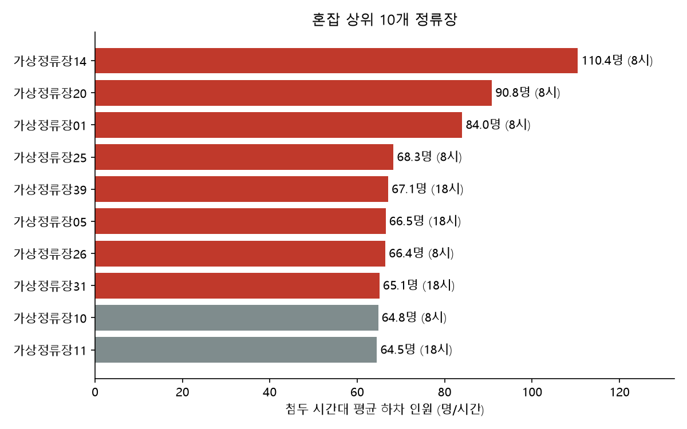
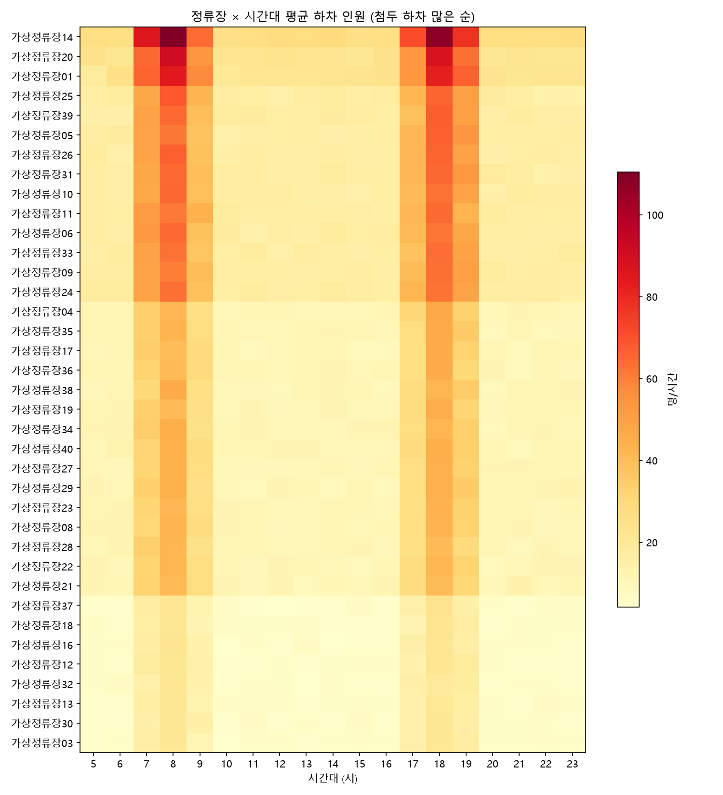
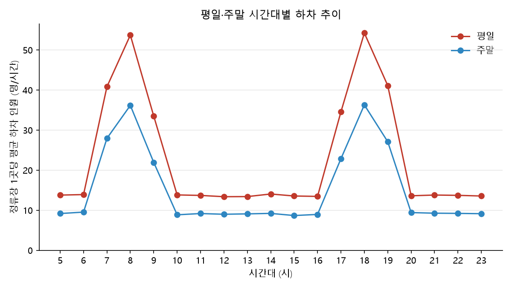
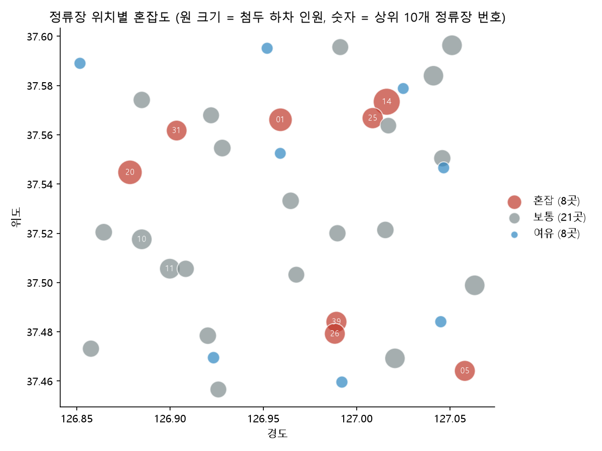

# 정류장 혼잡도 리포트

`viz_stop_congestion.py`가 생성한 문서. 직접 고치지 말고 스크립트를 다시 실행한다.

## 기준

- 기간: 2026-09-01 ~ 2026-09-14 (14일), 5~23시
- 대상: 하차 기록이 있는 정류장 37곳 (노선이 지나지 않는 정류장 3곳 제외)
- 혼잡도: 정류장의 시간당 평균 하차 인원. 여러 노선이 지나는 정류장은 노선을 합산
- 등급: 첨두 시간대 하차 인원 기준 상위 20% 혼잡, 하위 20% 여유, 나머지 보통
- 한계: 승차 인원·차량 정원 데이터가 없어 하차 인원을 혼잡도의 대리 지표로 사용

## 혼잡 상위 10개 정류장

| 순위 | 정류장 | 등급 | 첨두 시간대 | 첨두 하차(명/시간) | 일평균 하차(명) | 경유 노선 수 |
|---|---|---|---|---|---|---|
| 1 | 가상정류장14 | 혼잡 | 8시 | 110.4 | 861 | 5 |
| 2 | 가상정류장20 | 혼잡 | 8시 | 90.8 | 703 | 4 |
| 3 | 가상정류장01 | 혼잡 | 8시 | 84.0 | 696 | 4 |
| 4 | 가상정류장25 | 혼잡 | 8시 | 68.3 | 530 | 3 |
| 5 | 가상정류장39 | 혼잡 | 18시 | 67.1 | 523 | 3 |
| 6 | 가상정류장05 | 혼잡 | 18시 | 66.5 | 520 | 3 |
| 7 | 가상정류장26 | 혼잡 | 8시 | 66.4 | 517 | 3 |
| 8 | 가상정류장31 | 혼잡 | 18시 | 65.1 | 523 | 3 |
| 9 | 가상정류장10 | 보통 | 8시 | 64.8 | 514 | 3 |
| 10 | 가상정류장11 | 보통 | 18시 | 64.5 | 520 | 3 |

## 등급별 정류장

| 등급 | 정류장 수 | 첨두 하차 범위(명/시간) | 평균 일 하차(명) | 평균 경유 노선 수 |
|---|---|---|---|---|
| 혼잡 | 8 | 65.1 ~ 110.4 | 609 | 3.5 |
| 보통 | 21 | 41.5 ~ 64.8 | 396 | 2.3 |
| 여유 | 8 | 21.1 ~ 23.1 | 175 | 1.0 |

## 정류장 × 시간대

## 평일·주말 비교

| 구분 | 정류장 1곳당 일 하차(명) | 첨두 시간대 | 첨두 하차(명/시간) |
|---|---|---|---|
| 평일 | 435.5 | 18시 | 54.2 |
| 주말 | 290.8 | 18시 | 36.3 |

## 정류장 위치

